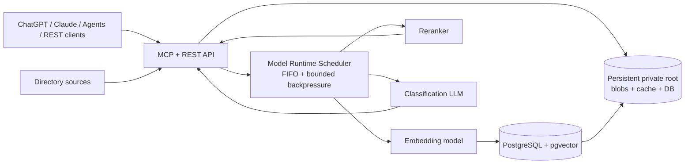
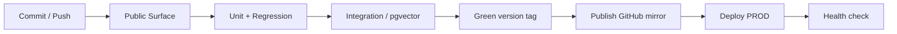

<div align="center">

# RAG MCP

### Self-hosted retrieval infrastructure for local AI systems

**Local embeddings · PostgreSQL/pgvector · model-aware GPU scheduling · reranking · MCP · automated production delivery**


RAG MCP turns a private technical library into a **source-traceable retrieval platform** that can be queried from ChatGPT, Claude, local agents, REST clients and MCP-aware tooling while keeping model execution and data under operator control.

</div>

---

## Why this project exists

Most local RAG demos stop at “embed files and run similarity search.” RAG MCP is built as an **operational system** instead:

- documents have lifecycle, quality gates, retry semantics and provenance;
- PostgreSQL + pgvector owns retrieval state;
- collections have explicit search policy instead of agent-side guessing;
- reranking is a first-class runtime stage;
- local LLMs are scheduled around finite VRAM instead of loaded ad hoc;
- automatic classification can route documents into an existing taxonomy;
- directory sources synchronize incrementally;
- MCP and REST expose the same retrieval truth;
- CI/CD validates, tags, publishes to GitHub and deploys production automatically;
- persistent application state is owned by one durable host path and survives every deployment.

This repository is the **public product**. Installation-specific runtime data and recovery material are deliberately kept outside it.

---

## Architecture at a glance



### Model-aware GPU runtime

The GPU is treated as a **finite shared resource**. Model-dependent work enters a bounded FIFO scheduler. Each caller keeps its own future/result, while the scheduler controls only **when** the operation may use the model runtime.

A semantic query is one atomic runtime job:

```text
query
  -> ensure embedding + reranker are resident
  -> embed query
  -> pgvector retrieval
  -> rerank candidates
  -> return to the original caller
```

An automatically classified document uses a different profile:

```text
upload
  -> extract / chunk
  -> embedding job
  -> document becomes ready
  -> classification job enters FIFO
  -> unload incompatible resident models if required
  -> reuse the configured embedding model
  -> classify
  -> classify against existing collection profiles
  -> next incompatible job determines the next resident profile
```

Classification is embedding-based and does not require a separate generative LLM residency cycle.

---

## Core capabilities

### Retrieval

- PostgreSQL + pgvector semantic search
- HNSW retrieval with configurable search parameters
- configurable reranking with fail-open fallback
- source path, document, chapter/page/heading metadata in results
- explicit collection filters when requested
- **global search by default** across collections whose `Default search` flag is ON
- collections with `Default search` OFF remain searchable when explicitly selected

### Ingestion

- PDF, EPUB, HTML, Markdown, TXT, DOCX and source/text formats
- extraction cache and quality gating
- configurable chunking and embedding batches
- encoding recovery including UTF-8, CP1252 and Latin-1 before rejecting corrupted text
- retry/cancel/reindex lifecycle
- persistent progress after restart

### Automatic collection routing

`Automatic classification` can be selected as the import destination.

1. the document enters an `Unclassified` inbox with `Default search` OFF;
2. ingestion and embedding finish first;
3. classification compares the document embedding with profiles of existing user-defined collections;
4. an existing collection is applied only when semantic score and winner margin thresholds are satisfied;
5. weak or ambiguous matches stay available for review;
6. new collections are **never created automatically**.

### Directory sources

A collection can watch a server-visible directory on a configurable cadence:

```text
new file      -> ingest
changed file  -> reindex
removed file  -> remove indexed document
```

Exclude patterns and intervals are configuration-owned rather than hardcoded.

### MCP

The server exposes Streamable HTTP MCP at:

```text
/mcp
```

Current MCP surface includes semantic search, retrieval metrics, collection discovery and document access. MCP clients do not guess a collection by default; relevance is owned by retrieval/reranking.

### Secure private ChatGPT access

Production supports an optional **OpenAI Secure MCP Tunnel sidecar**. The public app never exposes an additional public MCP listener and never owns tunnel credentials inside the image.

---

## Persistent production model

Production follows the same deployment principle used by REACH: **one operator-owned persistent root**.

```text
RAG_PRIVATE_PATH/
├── .env
├── data/
│   ├── blobs/
│   └── extraction-cache/
└── postgres/
```

The deploy controller:

- reuses an existing root;
- creates a missing root once;
- never deletes or replaces it;
- never requires the private Git repository to be deployed;
- mounts the same root into PostgreSQL and the RAG application;
- generates first-run infrastructure credentials when starting from an empty root.

The private Git repository is **recovery/configuration material**, not production storage.

---

## CI/CD



A failed validation blocks publication and deployment. Green builds receive deterministic tags using the same version contract as the other infrastructure projects.

---

## Repository layout

```text
rag-mcp/
├── app/
│   ├── api.py
│   ├── classification_runtime.py
│   ├── ingest.py
│   ├── model_runtime.py
│   ├── mcp_server.py
│   ├── search.py
│   ├── rerank.py
│   ├── source_sync.py
│   └── static/
├── config/
│   └── defaults.yaml
├── deploy/
│   └── prod/
├── docs/
├── scripts/
├── tests/
├── Dockerfile
└── docker-compose.yml
```

The canonical architecture document is [docs/architecture.md](docs/architecture.md).

---

## Quick start — development

```bash
git clone https://github.com/apinheiro99/rag-mcp.git
cd rag-mcp
cp .env.example .env
./start.sh
```

Then open:

```text
http://localhost:8000
```

The normal development stack uses the public repository plus an operator-selected private root through `RAG_PRIVATE_PATH`.
The development stack is **on-demand**: containers do not auto-restart after host/container restarts. Run `./start.sh` only when local DEV validation is needed, and stop it afterwards with `docker compose stop`.

---

## Production deployment

Production uses `deploy/prod/compose.yml` and the persistent host root supplied in `RAG_PRIVATE_PATH`.

```bash
export RAG_PRIVATE_PATH=/absolute/path/to/rag-private
bash scripts/deploy-prod.sh
```

On first deployment, a missing private root is created. Existing state is reused on every subsequent deployment.

---

## Move an existing RAG installation to production

The migration helper deliberately uses a **logical PostgreSQL dump** instead of copying a running PostgreSQL data directory.

### 1. Export on the current server

```bash
./scripts/migrate-rag-data.sh export /tmp/rag-data.tar.gz docker-compose.yml .env
```

The bundle contains:

- a PostgreSQL `pg_dump` archive;
- `data/` blobs and extraction cache;
- a small migration manifest.

### 2. Transfer the bundle to the production host

Use the operator's normal file-transfer/shared-storage mechanism.

### 3. Import on production

```bash
export RAG_PRIVATE_PATH=/absolute/path/to/production/rag-private
./scripts/migrate-rag-data.sh import /path/to/rag-data.tar.gz deploy/prod/compose.yml "$RAG_PRIVATE_PATH/.env"
```

Existing production `data/` is moved to a timestamped pre-migration backup before replacement.

---

## Install with an AI coding agent

The repository includes [docs/INSTALL_WITH_CLAUDE_CODE.md](docs/INSTALL_WITH_CLAUDE_CODE.md), but the following prompt is intentionally provider-neutral and can be pasted into Claude Code, Codex, ChatGPT Work or another capable coding agent.

### Copy/paste installation prompt

```text
Install and configure the public RAG MCP project from:
https://github.com/apinheiro99/rag-mcp

Goal:
Run a self-hosted RAG server using Docker Compose, PostgreSQL/pgvector and an existing LM Studio instance. Keep all installation-specific runtime state outside the public repository in one persistent directory referenced by RAG_PRIVATE_PATH.

Rules:
1. Do not commit secrets, credentials, database files, uploaded documents or runtime state to the public repository.
2. Do not invent hardcoded infrastructure values when an existing config/default/environment mechanism exists.
3. Use the repository's current Docker/Compose files and documented scripts rather than replacing the architecture.
4. Preserve the public/private split: public source in rag-mcp; runtime data under RAG_PRIVATE_PATH.
5. Do not disable TLS verification or security checks to make setup pass.
6. Validate every step before continuing.

Tasks:
- clone the repository;
- inspect README.md, .env.example and docs/architecture.md;
- create an operator-owned persistent RAG_PRIVATE_PATH outside the repository;
- create/configure the runtime .env without exposing its values in logs;
- point LMSTUDIO_URL at the user's existing LM Studio server;
- start PostgreSQL/pgvector and the RAG application;
- verify /api/health;
- verify the Web UI;
- verify /mcp using a real MCP client/session and list the exposed tools;
- confirm the configured embedding model is available;
- confirm the configured reranker is available;
- do not select a generative model as the reranker;
- ingest one small document into a test collection;
- run one semantic query and confirm source-traceable results;
- report exactly what was configured, what was validated and anything still requiring operator action.

If Secure MCP Tunnel credentials are already available, use the repository's optional tunnel sidecar and route only the MCP endpoint. If they are not available, leave the tunnel disabled and report the missing operator-side tunnel_id/credentials without inventing them.
```

---

## Design informed by the RAG itself

RAG MCP is also used to research its own architecture. During the model-runtime scheduler redesign, the running RAG corpus returned material that directly informed the implementation:

- **Unmesh Joshi — _Patterns of Distributed Systems_**, Chapter 13, **“Singular Update Queue”**: single-consumer ordering for asynchronous work.
- **Michael T. Nygard — _Release It!_**, **“Create Back Pressure”**: bounded queues prevent a finite consumer from being overwhelmed by unbounded producers.
- **_Building AI-Intensive Python Applications_**, Chapter 6, **“Model serving strategies”**: model-serving/runtime tradeoffs.
- **_Building AI Agents with LLMs, RAG, and Knowledge Graphs_**, Chapter 6, **“Inference optimization”** and **“Asynchronous programming and ML”**.

These are not decorative citations: the scheduler implementation in `app/model_runtime.py` includes the relevant design references next to the code they influenced.

---

## Engineering principles

- **one canonical owner per responsibility**;
- **configuration over hardcoded operational values**;
- **KISS/YAGNI before framework expansion**;
- persistent state must survive deployment independently of source code;
- agents do not silently guess collection scope;
- model residency is a runtime scheduling problem, not scattered load/unload calls;
- database migrations and data movement favor recoverable/logical operations over unsafe raw copies;
- validation must block deployment rather than document failure after the fact.

---

## Current state

Operational today:

- ingestion and quality gates;
- PostgreSQL/pgvector retrieval;
- local embedding + reranking;
- bounded FIFO GPU/model scheduler;
- post-embedding automatic classification;
- directory synchronization;
- MCP and REST access;
- administration UI;
- GitLab CI/CD;
- public GitHub mirror;
- production Docker deployment;
- persistent private root;
- migration tooling;
- optional Secure MCP Tunnel integration.

The project is actively evolving, but the architecture is deliberately production-oriented rather than demo-oriented.

---

<div align="center">

**Built as infrastructure, not a notebook demo.**

</div>
