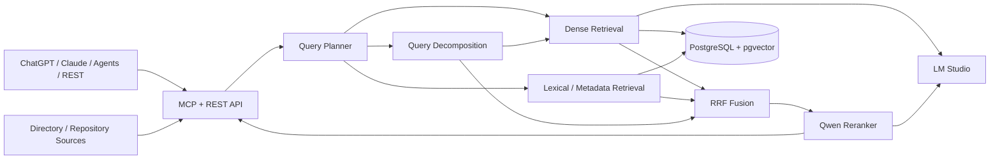
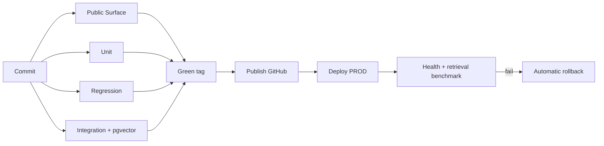

<div align="center">

# RAG MCP

### Production-grade, self-hosted retrieval infrastructure for AI agents

**Hybrid retrieval · PostgreSQL/pgvector · adaptive top-k · query decomposition · reranking · MCP · local model runtime · CI/CD**


**RAG MCP turns a private technical library into a source-traceable retrieval platform for ChatGPT, Claude, local agents and REST/MCP clients — while keeping data and model execution under operator control.**

</div>

---

## What makes this different

Most RAG demos stop at `embed → vector search → answer`.

RAG MCP is built as an **operational retrieval system**:

- hybrid dense + lexical retrieval with reciprocal-rank fusion;
- query-aware retrieval for technical terms, book titles and named concepts;
- adaptive `top_k` to avoid returning twenty weak chunks when three strong ones are enough;
- deterministic query decomposition for compound comparison questions;
- pgvector/HNSW retrieval with configurable search behavior;
- Qwen embedding + reranker runtime with explicit GPU residency control;
- source-traceable results with document, path, chapter/page/heading metadata;
- document ingestion, extraction quality gates, retries, cancellation and reindexing;
- directory/repository source synchronization;
- category-based document classification using existing taxonomy only;
- REST + MCP access over the same retrieval truth;
- retrieval metrics, recent activity, timings and provenance;
- CI/CD with validation, version tags, GitHub publication, production deployment and rollback.

---

## Architecture



### Retrieval pipeline

```text
query
  ↓
query intent analysis
  ├─ simple semantic query ─────────────→ dense retrieval
  ├─ technical/title query ─────────────→ dense + lexical/metadata
  └─ explicit compound comparison ─────→ bounded query decomposition
                                               ↓
                                      reciprocal-rank fusion
                                               ↓
                                         Qwen reranker
                                               ↓
                                      adaptive result cutoff
                                               ↓
                               source-traceable final context
```

---

## Engineering highlights

### Hybrid retrieval that understands query shape

RAG MCP does not blindly run every retrieval strategy for every request.

It detects when the query contains signals such as technical identifiers and acronyms, named concepts, quoted phrases, book-title-like phrases, and explicit multi-part comparisons.

Dense retrieval remains the baseline. Lexical and metadata retrieval are activated only when they add useful signal, and candidate rankings are fused before reranking.

### Adaptive `top_k`

`top_k` is treated as a **ceiling**, not an obligation. When relevance falls sharply after the first few chunks, the system returns the useful prefix instead of padding context with noise.

### Query decomposition without an extra LLM

Compound questions such as:

```text
Compare the Strategy pattern with an Aggregate Root:
what problem does each solve?
```

can be decomposed deterministically into bounded subqueries, retrieved in parallel and fused before final reranking.

No extra generative model is required for the normal retrieval path.

### GPU residency is explicit

Normal retrieval uses:

```text
Qwen embedding model
+
Qwen reranker
```

The runtime keeps the required profile resident and evicts incompatible extra models instead of letting VRAM accumulate unpredictably.

### Search is observable

Retrieval events capture query, collections and filters, dense/lexical/rerank timings, effective `top_k`, hybrid/decomposition usage, candidate counts, scores and provenance.

---

## Screenshots

Product screenshots are intentionally kept as repository assets under `docs/images/`.

The portfolio README uses three primary views:

- Dashboard / runtime overview
- Documents and classification
- Settings / Directory Sources

<!--


-->

---

## MCP

Streamable HTTP MCP endpoint:

```text
/mcp
```

Core operations include semantic/hybrid search, retrieval metrics, collection discovery and document retrieval.

---

## Ingestion

Supported workflows include PDF, EPUB, AZW3, HTML, Markdown, TXT, DOCX, source-code/text formats and recursive directory/repository synchronization.

The ingestion lifecycle includes extraction, chunking, embedding, retries, quality validation and persistent progress.

---

## Taxonomy

The library uses explicit top-level collections and user-managed categories.

Classification rules:

- categories are created by the user;
- the classifier only chooses among categories that already exist;
- it never invents taxonomy silently;
- when no existing category matches, the document remains uncategorized.

Manual `Classify` and automatic classification use the same runtime.

---

## Production data model

Runtime state lives outside the public repository:

```text
RAG_PRIVATE_PATH/
├── .env
├── data/
│   ├── blobs/
│   └── extraction-cache/
└── postgres/
```

The repository contains code and defaults. The private root contains operator/runtime state.

---

## CI/CD



A release is published only from the tested SHA.

---

## Quick start

```bash
git clone https://github.com/apinheiro99/rag-mcp.git
cd rag-mcp
cp .env.example .env
./install.sh
./start.sh
```

Then open:

```text
http://localhost:8000
```

---

## Install it with Claude Code / Codex

Paste this prompt into **Claude Code, Codex, ChatGPT Work or another capable coding agent** on the target machine:

```text
Install RAG MCP from:

https://github.com/apinheiro99/rag-mcp

Read README.md, docs/architecture.md and docs/INSTALL_WITH_CLAUDE_CODE.md first.

Goal:
Run the project locally using Docker Compose with PostgreSQL/pgvector and an
existing LM Studio instance.

Rules:
- Do not redesign the architecture.
- Do not invent hardcoded defaults when configuration already exists.
- Keep runtime data, credentials, uploaded documents and PostgreSQL state
  outside the public repository under RAG_PRIVATE_PATH.
- Never commit secrets.
- Do not disable TLS or security validation to make setup pass.
- Ask me only for information that cannot be inferred safely.

Tasks:
1. Verify Docker, Docker Compose, Git and network prerequisites.
2. Clone the repository.
3. Inspect .env.example and create .env.
4. Ask me for the LM Studio URL and desired persistent RAG_PRIVATE_PATH only
   if they cannot be detected safely.
5. Run the repository's own installation/start scripts.
6. Start PostgreSQL/pgvector and the RAG application.
7. Validate /api/health, the web UI, PostgreSQL/pgvector connectivity,
   embedding access, reranker access and /mcp.
8. Run the repository test suite.
9. Perform one sample retrieval and confirm source provenance.
10. Return a short final report with services, URLs, persistent paths, models,
    test results and remaining manual steps.

Do not stop after generating instructions. Execute the installation and validation.
```

Longer install guide: [`docs/INSTALL_WITH_CLAUDE_CODE.md`](docs/INSTALL_WITH_CLAUDE_CODE.md)

---

## Repository layout

```text
rag-mcp/
├── app/
│   ├── api.py
│   ├── ingest.py
│   ├── search.py
│   ├── rerank.py
│   ├── model_runtime.py
│   ├── source_sync.py
│   ├── mcp_server.py
│   └── static/
├── config/
├── deploy/
├── docs/
├── examples/evaluation/
├── scripts/
├── tests/
├── Dockerfile
└── docker-compose.yml
```

---

## Design principles

- **No hidden infrastructure constants** when configuration is appropriate.
- **Retrieval quality before prompt cleverness.**
- **Tests before production deployment.**
- **One source of truth for manual and automatic behavior.**
- **Persistent state is never owned by the container image.**
- **Failures should be observable and recoverable.**
- **A deployment must prove both correctness and retrieval quality.**

---

## Why I built it

RAG MCP is part of a broader engineering platform built around **agentic software delivery, infrastructure automation and locally operated AI systems**.

The project focuses on a practical question:

> What does it take to turn local AI retrieval from a demo into infrastructure you can actually operate?

That means treating retrieval quality, model scheduling, persistence, testing, deployment, observability and failure recovery as one system — not as disconnected scripts.

---

## Author

Built and maintained by **André Pinheiro**.

## License

See [`LICENSE`](LICENSE).
