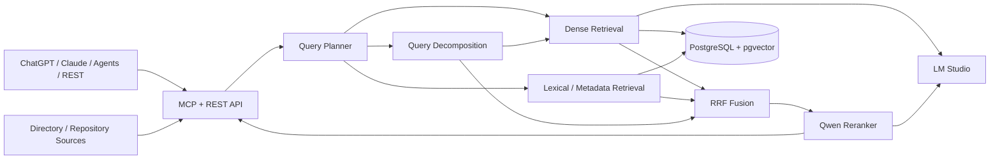
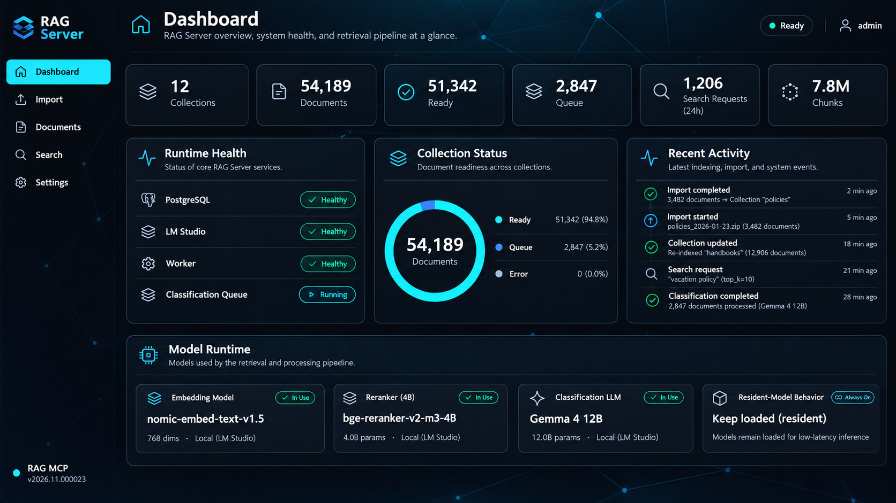
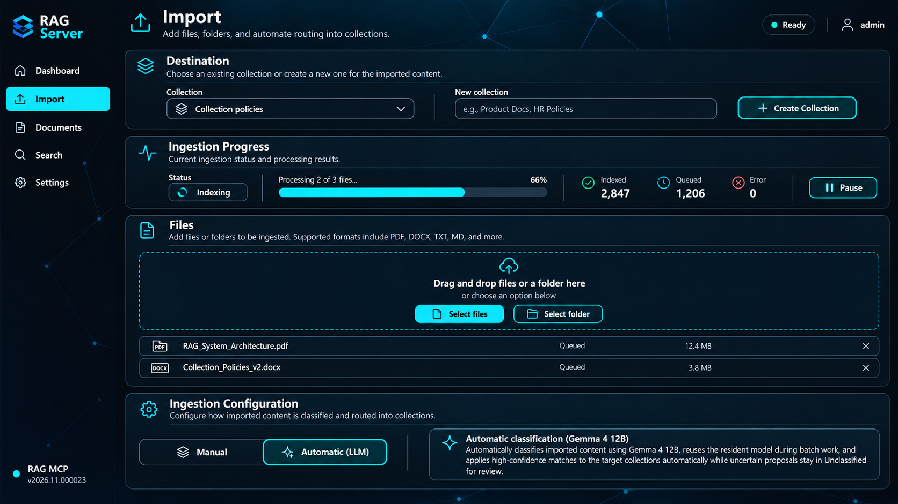
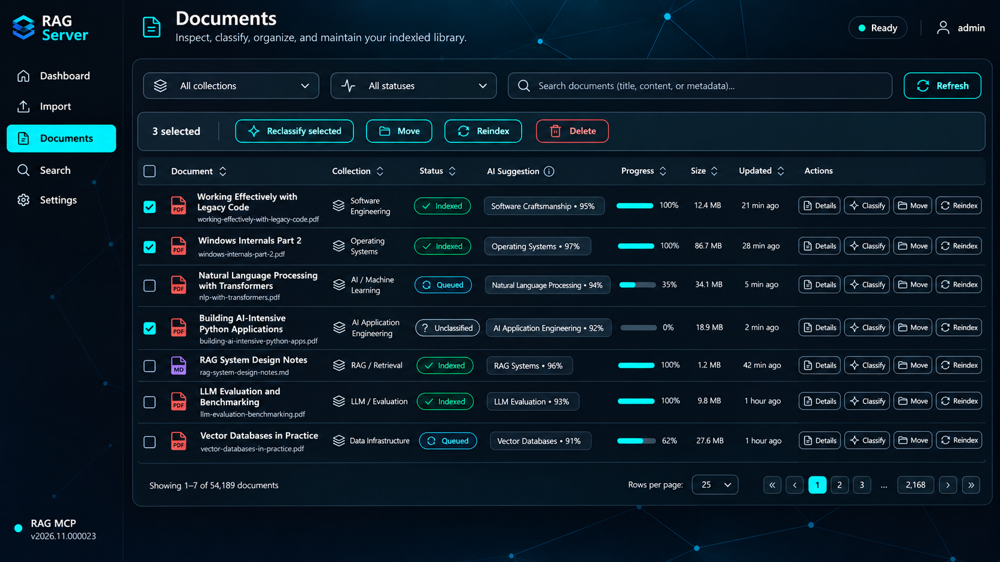
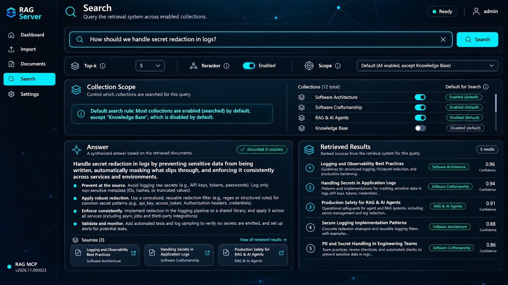
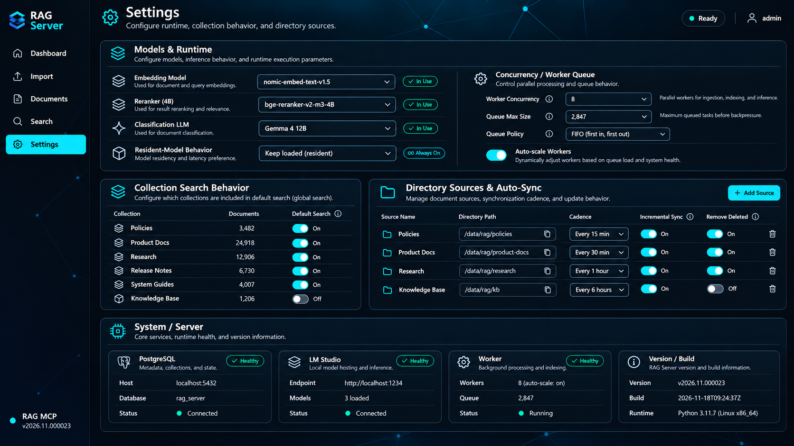
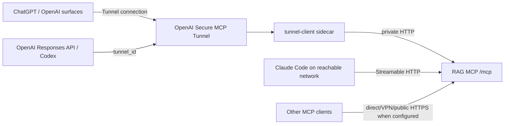
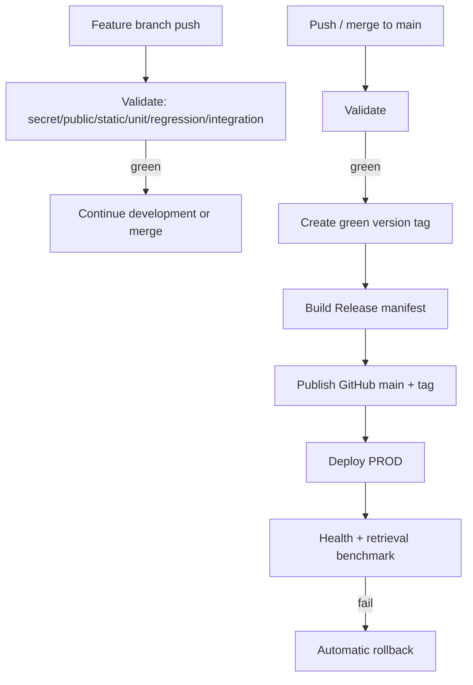

<div align="center">

# RAG MCP

### Production-grade, self-hosted retrieval infrastructure for AI agents

**Hybrid retrieval · PostgreSQL/pgvector · adaptive top-k · query decomposition · reranking · MCP · local model runtime · CI/CD**


**RAG MCP turns a private technical library into a source-traceable retrieval platform for ChatGPT, Claude, local agents and REST/MCP clients — while keeping data and model execution under operator control.**

</div>

---

## What makes this different

Most RAG demos stop at `embed → vector search → answer`.

RAG MCP is built as an **operational retrieval system**:

- hybrid dense + lexical retrieval with reciprocal-rank fusion;
- query-aware retrieval for technical terms, book titles and named concepts;
- adaptive `top_k` to avoid returning twenty weak chunks when three strong ones are enough;
- deterministic query decomposition for compound comparison questions;
- pgvector/HNSW retrieval with configurable search behavior;
- Qwen embedding + reranker runtime with explicit GPU residency control;
- source-traceable results with document, path, chapter/page/heading metadata;
- document ingestion, extraction quality gates, retries, cancellation and reindexing;
- directory/repository source synchronization;
- category-based document classification using existing taxonomy only;
- REST + MCP access over the same retrieval truth;
- retrieval metrics, recent activity, timings and provenance;
- CI/CD with validation, version tags, GitHub publication, production deployment and rollback.

---

## Architecture



### Retrieval pipeline

```text
query
  ↓
query intent analysis
  ├─ simple semantic query ─────────────→ dense retrieval
  ├─ technical/title query ─────────────→ dense + lexical/metadata
  └─ explicit compound comparison ─────→ bounded query decomposition
                                               ↓
                                      reciprocal-rank fusion
                                               ↓
                                         Qwen reranker
                                               ↓
                                      adaptive result cutoff
                                               ↓
                               source-traceable final context
```

---

## Engineering highlights

### Hybrid retrieval that understands query shape

RAG MCP does not blindly run every retrieval strategy for every request.

It detects when the query contains signals such as technical identifiers and acronyms, named concepts, quoted phrases, book-title-like phrases, and explicit multi-part comparisons.

Dense retrieval remains the baseline. Lexical and metadata retrieval are activated only when they add useful signal, and candidate rankings are fused before reranking.

### Adaptive `top_k`

`top_k` is treated as a **ceiling**, not an obligation. When relevance falls sharply after the first few chunks, the system returns the useful prefix instead of padding context with noise.

### Query decomposition without an extra LLM

Compound questions such as:

```text
Compare the Strategy pattern with an Aggregate Root:
what problem does each solve?
```

can be decomposed deterministically into bounded subqueries, retrieved in parallel and fused before final reranking.

No extra generative model is required for the normal retrieval path.

### GPU residency is explicit

Normal retrieval uses:

```text
Qwen embedding model
+
Qwen reranker
```

The runtime keeps the required profile resident and evicts incompatible extra models instead of letting VRAM accumulate unpredictably.

### Search is observable

Retrieval events capture query, collections and filters, dense/lexical/rerank timings, effective `top_k`, hybrid/decomposition usage, candidate counts, scores and provenance. Aggregated observability includes P95/P99 latency without imposing an arbitrary SLO gate.

---

## Screenshots

### Dashboard



### Import



### Documents and classification



### Search



### Settings and directory sources



The numbered files in `docs/screens/` are the visual reference set used by the runtime UI. The runtime intentionally keeps the currently approved application background instead of adopting `07_background.png`.

---

## MCP access

RAG MCP exposes a **read-only Streamable HTTP MCP** endpoint at:

```text
/mcp
```

Core operations include semantic/hybrid search, an experimental evidence graph, retrieval metrics, collection discovery and document retrieval. The endpoint uses the same retrieval implementation as the HTTP API.



### ChatGPT / OpenAI

The RAG server is intentionally private. For ChatGPT, Codex or the Responses API, use **OpenAI Secure MCP Tunnel** instead of exposing `/mcp` publicly. The repository already contains the optional `deploy/tunnel.compose.yml` sidecar and production deploy integration; the operator still needs to create the OpenAI tunnel, provision its runtime key/config outside the repository, associate the tunnel with the intended OpenAI organization/workspace, and connect it in ChatGPT.

High-level flow:

```text
ChatGPT / OpenAI
  -> OpenAI-hosted tunnel endpoint
  -> outbound tunnel-client connection
  -> http://app:8000/mcp inside the private Compose network
```

For current OpenAI setup details, see:

- https://developers.openai.com/api/docs/guides/secure-mcp-tunnels
- https://developers.openai.com/api/docs/guides/tools-connectors-mcp

### Claude Code

Claude Code does **not** use OpenAI Secure MCP Tunnel. If Claude Code runs on a host that can reach RAG MCP directly, add the Streamable HTTP endpoint:

```bash
claude mcp add --transport http rag-mcp http://docker-prod01.lab:8000/mcp
claude mcp list
```

If `RAG_API_TOKEN` is enabled, configure the corresponding `Authorization: Bearer ...` header in Claude Code's local MCP configuration. Keep credentials out of committed `.mcp.json` files. Inside Claude Code, `/mcp` shows connection/authentication status.

If Claude Code runs outside the private network, provide a network path it can actually reach (for example VPN/WireGuard or a separately secured public HTTPS MCP endpoint). OpenAI Secure MCP Tunnel is an OpenAI transport and is not a general tunnel for Claude Code.

### “Sign in with ChatGPT” is a different feature

OpenAI also offers **Sign in with ChatGPT** for eligible open-source applications. That flow lets an application call OpenAI's Responses API using a user's ChatGPT plan without an API key. It is **outbound model inference**, not an inbound MCP connection. Adding it to RAG MCP would let RAG MCP call OpenAI models; it would **not** make this RAG accessible from ChatGPT. The current architecture therefore keeps LM Studio as the model runtime and uses MCP/Tunnel for client access.

---

## Ingestion

Supported workflows include PDF, EPUB, AZW3, HTML, Markdown, TXT, DOCX, source-code/text formats and recursive directory/repository synchronization.

The ingestion lifecycle includes extraction, chunking, embedding, retries, quality validation and persistent progress.

---

## Taxonomy

The library uses explicit top-level collections and user-managed categories.

Classification rules:

- categories are created by the user;
- the classifier only chooses among categories that already exist;
- it never invents taxonomy silently;
- when no existing category matches, the document remains uncategorized.

Manual `Classify` and automatic classification use the same runtime.

---

## Production data model

Runtime state lives outside the public repository:

```text
RAG_PRIVATE_PATH/
├── .env
├── data/
│   ├── blobs/
│   └── extraction-cache/
└── postgres/
```

The repository contains code and defaults. The private root contains operator/runtime state.

---

## CI/CD



Feature branches **validate only**. They do not create tags, releases, GitHub publications or production deployments. A release is produced only from a validated `main` SHA. Failed pipelines remain pipeline evidence and do not create `*-fail` version tags.

---

## Two-minute local setup

The fastest path is:

1. install **LM Studio**;
2. download/load the two reference models below;
3. clone RAG MCP;
4. configure `.env`;
5. run `./install.sh && ./start.sh`;
6. open the UI and verify `/api/health` + `/mcp`.

### 1. LM Studio models

In **LM Studio → Discover**, search for:

| Role | Search/download name | Reference LM Studio model ID | Notes |
|---|---|---|---|
| Embeddings | `Qwen3-Embedding-8B` | `text-embedding-qwen3-embedding-8b` | 4096-dimensional embeddings; required by the reference deployment |
| Reranker | `Qwen3-Reranker-4B` | `qwen3-reranker-4b` | resident reranker used by the reference deployment |

Choose a **4-bit quantization or better** when your hardware permits. The exact GGUF publisher/file is intentionally not hardcoded because LM Studio's catalog evolves. The canonical upstream model names are `Qwen/Qwen3-Embedding-8B` and `Qwen/Qwen3-Reranker-4B`.

Start the LM Studio local server and confirm the model catalog is visible at:

```bash
curl http://127.0.0.1:1234/v1/models
```

The reference deployment currently expects/selects:

```text
text-embedding-qwen3-embedding-8b
qwen3-reranker-4b
```

If your LM Studio exposes different IDs, select those IDs in RAG MCP Settings instead of renaming models artificially.

### 2. Install RAG MCP

```bash
git clone https://github.com/apinheiro99/rag-mcp.git
cd rag-mcp
cp .env.example .env
./install.sh
./start.sh
```

Then open:

```text
http://localhost:8000
```

Smoke test:

```bash
curl http://localhost:8000/api/health
curl http://localhost:8000/mcp
```

If `RAG_API_TOKEN` is configured, send the matching bearer token for protected API/MCP requests.

---

## Install it with Claude Code / Codex

Paste this prompt into **Claude Code, Codex, ChatGPT Work or another capable coding agent** on the target machine:

```text
Install RAG MCP from:

https://github.com/apinheiro99/rag-mcp

Read README.md, docs/architecture.md and docs/INSTALL_WITH_CLAUDE_CODE.md first.

Goal:
Run the project locally using Docker Compose with PostgreSQL/pgvector and an
existing LM Studio instance.

Rules:
- Do not redesign the architecture.
- Do not invent hardcoded defaults when configuration already exists.
- Keep runtime data, credentials, uploaded documents and PostgreSQL state
  outside the public repository under RAG_PRIVATE_PATH.
- Never commit secrets.
- Do not disable TLS or security validation to make setup pass.
- Ask me only for information that cannot be inferred safely.

Tasks:
1. Verify Docker, Docker Compose, Git and network prerequisites.
2. Verify LM Studio is installed and its local server is reachable.
3. Inspect `GET <LMSTUDIO_URL>/v1/models`. If the reference models are absent, tell me exactly what must be downloaded in LM Studio Discover:
   - `Qwen3-Embedding-8B` (reference ID `text-embedding-qwen3-embedding-8b`);
   - `Qwen3-Reranker-4B` (reference ID `qwen3-reranker-4b`).
   Do not silently substitute a different embedding dimension or reranker family.
4. Clone the repository.
5. Inspect .env.example and create .env.
6. Ask me for the LM Studio URL and desired persistent RAG_PRIVATE_PATH only
   if they cannot be detected safely.
7. Run the repository's own installation/start scripts.
8. Start PostgreSQL/pgvector and the RAG application.
9. Validate /api/health, the web UI, PostgreSQL/pgvector connectivity,
   embedding access, reranker access and /mcp.
10. Run the repository test suite.
11. Perform one sample retrieval and confirm source provenance.
12. If this machine runs Claude Code and can reach the RAG server, offer to add
    the HTTP MCP endpoint with `claude mcp add --transport http rag-mcp <RAG_URL>/mcp`.
13. If ChatGPT/OpenAI access is desired, explain that the private deployment
    requires OpenAI Secure MCP Tunnel provisioning and that this is separate
    from installing the RAG itself.
14. Return a short final report with services, URLs, persistent paths, models,
    test results, MCP connectivity and remaining manual steps.

Do not stop after generating instructions. Execute the installation and validation.
```

Longer install guide: [`docs/INSTALL_WITH_CLAUDE_CODE.md`](docs/INSTALL_WITH_CLAUDE_CODE.md)

---

## Repository layout

```text
rag-mcp/
├── app/
│   ├── api.py
│   ├── ingest.py
│   ├── search.py
│   ├── rerank.py
│   ├── model_runtime.py
│   ├── source_sync.py
│   ├── mcp_server.py
│   └── static/
├── config/
├── deploy/
├── docs/
├── examples/evaluation/
├── scripts/
├── tests/
├── Dockerfile
└── docker-compose.yml
```

---

## Design principles

- **No hidden infrastructure constants** when configuration is appropriate.
- **Retrieval quality before prompt cleverness.**
- **Tests before production deployment.**
- **One source of truth for manual and automatic behavior.**
- **Persistent state is never owned by the container image.**
- **Failures should be observable and recoverable.**
- **A deployment must prove both correctness and retrieval quality.**

---

## Why I built it

RAG MCP is part of a broader engineering platform built around **agentic software delivery, infrastructure automation and locally operated AI systems**.

The project focuses on a practical question:

> What does it take to turn local AI retrieval from a demo into infrastructure you can actually operate?

That means treating retrieval quality, model scheduling, persistence, testing, deployment, observability and failure recovery as one system — not as disconnected scripts.

---

## Author

Built and maintained by **André Pinheiro**.

## License

See [`LICENSE`](LICENSE).
