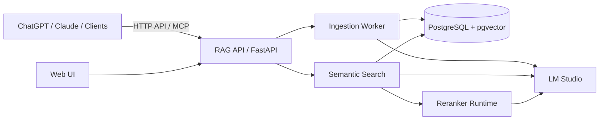
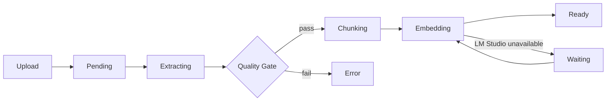
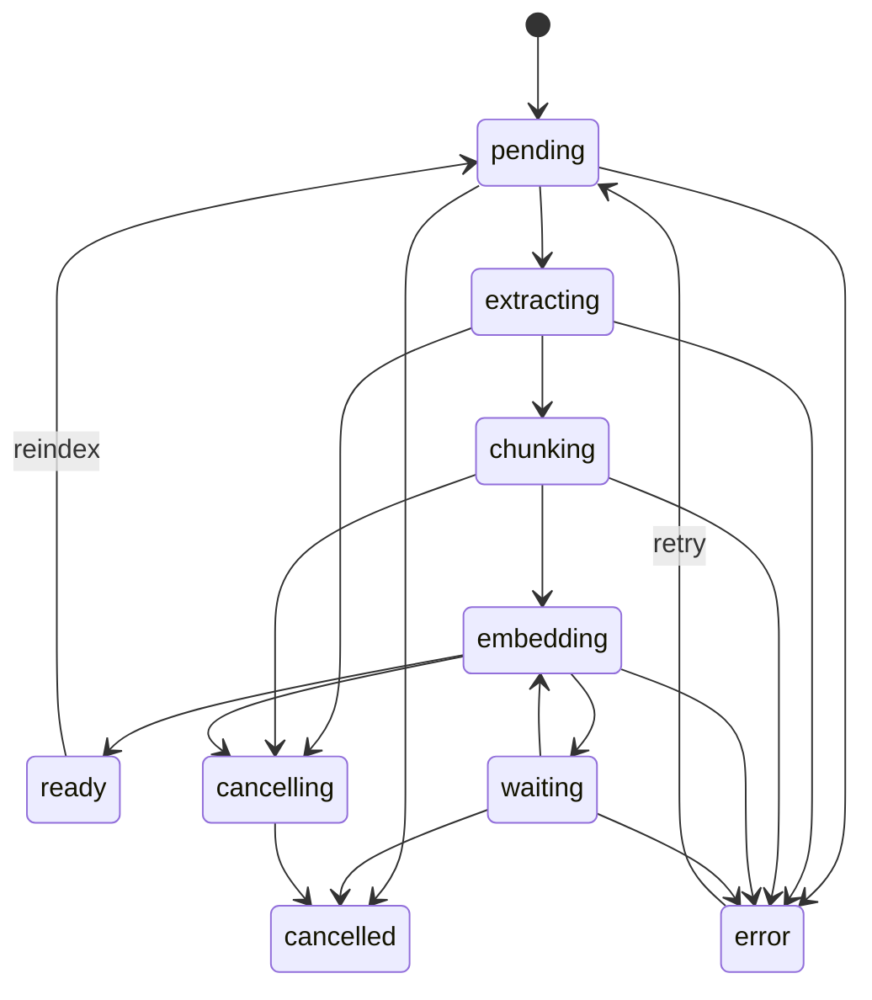
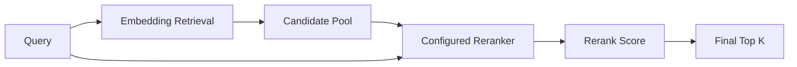
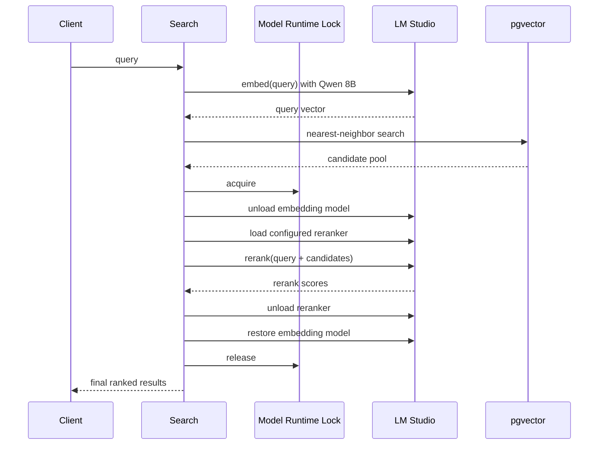
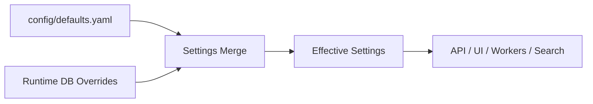

# RAG MCP — Architecture

**Status:** arquitetura operacional em evolução ativa.  
**Audience:** desenvolvedores e agentes que precisam entender, modificar, operar ou validar o RAG MCP.  
**Authority:** este arquivo é a fonte arquitetural única do RAG MCP: estado atual, decisões, configuração relevante, diagramas, invariantes, validação e próximos experimentos.

---

## 1. Mental model

RAG MCP é um serviço self-hosted que transforma documentos em conhecimento pesquisável e expõe esse conhecimento por API HTTP, MCP e UI.

O sistema tem quatro responsabilidades principais:

1. **Ingestão:** receber documento, extrair, validar, chunkar, gerar embeddings e persistir.
2. **Retrieval:** transformar pergunta em embedding, buscar candidatos no pgvector, aplicar filtros e opcionalmente reranquear.
3. **Operação:** configurar modelos/defaults, acompanhar fila, cancelar/reindexar documentos e observar métricas.
4. **Integração:** permitir que ChatGPT, Claude e outros clientes consultem a mesma base via MCP/API.

Fluxo mental:

```text
documento
  -> extraction
  -> quality gate
  -> chunks
  -> embedding model
  -> PostgreSQL + pgvector

pergunta
  -> embedding model
  -> pgvector candidates
  -> optional reranker
  -> resultados com rastreabilidade
```

---

## 2. Boundaries

### RAG MCP owns

- ingestão e lifecycle de documentos;
- extração por formato;
- validação de qualidade do texto;
- chunking;
- embeddings;
- armazenamento e índices vetoriais;
- busca semântica e filtros;
- reranking opcional;
- métricas de retrieval;
- API HTTP;
- MCP read-only;
- UI operacional;
- settings de runtime;
- reindexação, retry e cancelamento por documento.

### RAG MCP does not own

- o conteúdo-fonte original;
- administração geral da máquina;
- governança de outros projetos;
- política de rede do ambiente;
- administração genérica do LM Studio;
- gerenciamento corporativo de segredos;
- verdade canônica do conteúdo da KB: o RAG recupera o que foi indexado; curadoria/canonicalidade é responsabilidade do corpus.

A KB privada pode conter credenciais operacionais. No modelo deste projeto elas são conhecimento válido e devem continuar recuperáveis quando a consulta as pede.

---

## 3. Runtime topology



Reference runtime currently observed:

- local API: `http://127.0.0.1:8000`
- LAN API: `http://192.168.1.142:8000`
- LM Studio: `http://192.168.1.10:1234`

These addresses are deployment facts, not architecture requirements.

---

## 4. Code ownership map

| Module | Responsibility |
|---|---|
| `main.py` | process composition / FastAPI startup |
| `api.py` | administrative and search HTTP API |
| `mcp_server.py` | read-only MCP surface |
| `settings.py` | runtime settings + defaults/overrides resolution |
| `config.py` | environment/default configuration loading |
| `db.py` | PostgreSQL access and vector table helpers |
| `schema.sql` | persistence schema |
| `extraction.py` | document parsing and parser dispatch |
| `quality.py` | extracted-text quality gate |
| `chunking.py` | chunk generation |
| `ingest.py` | persistent/resumable ingestion worker |
| `ingest_policy.py` | upload/ingestion policy |
| `search.py` | semantic retrieval orchestration |
| `search_filters.py` | validated retrieval filters |
| `retrieval_observability.py` | retrieval event persistence/metrics |
| `lmstudio.py` | LM Studio transport, embeddings, chat, model lifecycle |
| `rerank.py` | rerank prompt, response parsing and ordering |
| `rerank_runtime.py` | model-switch orchestration and fail-open behavior |
| `autoconfig.py` | ingestion configuration suggestion |
| `collection_classifier.py` | Embedding-based collection routing against existing user-defined collections |
| `source_sync.py` | incremental directory-source synchronization + scheduler |

Rule: one owner per responsibility. New behavior should extend the owning module instead of creating parallel policy elsewhere.

---

## 5. Persistence model

Core tables:

### `settings`
Persistent runtime configuration.

### `collections`
Logical knowledge bases. A collection records the embedding model/dimension that owns its vectors.

### `documents`
Lifecycle record for each uploaded/indexed source. Directory-managed documents also record their `source_id` and source mtime.

### `collection_sources`
Configurable server-visible directory sources with interval, exclusions, last-sync state and incremental synchronization metadata.

### `chunks`
Derived text chunks linked to both document and collection.

`chunks.document_id` and `chunks.collection_id` use `ON DELETE CASCADE`.

### vector tables
Dimension-specific pgvector storage. Vector rows reference chunks; deleting a chunk/document removes derived vector state through cascading relationships.

### `events`
Operational events.

### `retrieval_events`
Search observability including timing, candidates, result counts, score and errors.

Derived extraction cache is not authoritative and may be deleted/rebuilt.

---

## 6. Ingestion lifecycle



Other states include waiting/error/cancelling/cancelled as appropriate.

The pipeline is designed to be restartable and progress-aware. Existing embedded chunks are not intentionally recomputed on an ordinary worker restart.

### Extraction dispatch

Public contract remains:

`extract(path, filename, sample=False, ...)`

Specialized detectors run before generic fallbacks.

Current specialized parsers:

- ChatGPT Data Export JSON;
- ChatGPT Data Export HTML with embedded JSON;
- generic JSON;
- JSONL/NDJSON.

ChatGPT export parsing intentionally keeps useful semantic content such as title, user/assistant messages and timestamps while excluding raw mapping identifiers and hidden/system noise.

### Reindex invariant

Reindex is not "reuse the old parser forever".

It:
- removes old chunks;
- resets progress/status;
- removes extraction cache;
- re-runs extraction;
- therefore re-runs parser detection against current content/code.

---

## 7. Quality gate

`quality.py` validates extracted text before expensive embedding work.

Quality failures are document-level failures and do not stop unrelated documents.

Examples already observed in production:
- text too short;
- mojibake percentage above configured threshold.

Quality policy belongs to configuration and must not be silently hardcoded per document. Text decoding attempts UTF-8/UTF-8-SIG and common legacy encodings such as CP1252 before the quality gate declares mojibake/corruption.

---

## 8. Cancellation contract

Per-document cancellation is cooperative and idempotent.

### Immediate case
Pending/waiting documents can be cancelled without interrupting the rest of the queue.

### Active case
An active document transitions to `cancelling`. The worker checks cancellation at safe boundaries, stops processing, removes partial chunks, resets counters and finishes as `cancelled`.

Because vectors are derived from chunks and linked through cascading deletion, cleanup removes partial vector state as well.

Repeated cancel requests must remain safe.

### Document lifecycle state machine



---

## 9. Retrieval pipeline

### Base retrieval


Search can span collections that use compatible embedding model/dimension groups. With no explicit collection filter, retrieval searches every collection whose `Default search` flag is ON. A collection filter is only applied when the caller explicitly requests it; explicit selection can search a collection even when its default flag is OFF.

Returned results preserve:
- chunk id;
- document id;
- content;
- vector score;
- collection;
- source filename/path;
- location metadata;
- document metadata.

### Filters

Current search filters include document IDs, authors, source paths, chapters and pages.

---

## 10. Reranking

Reranking is a second retrieval stage. It does **not** replace embeddings.



The original vector `score` remains intact. Reranking adds `rerank_score`.

### Model roles

Three roles are explicit:

- `embedding_model`
- `llm_model`
- `reranker_model`

Reference deployment current reranker:
`qwen3-reranker-4b` (resident runtime override)

Repository fallback/default remains configuration-driven in `config/defaults.yaml`.

Current embedding:
`text-embedding-qwen3-embedding-8b`

### Switch mode

Initial approved mode is model switching:

1. generate query embedding;
2. retrieve larger candidate pool;
3. acquire global model runtime lock;
4. unload embedding model;
5. load reranker;
6. rerank;
7. unload reranker;
8. restore embedding model in `finally`;
9. release lock.

The ingestion worker uses the same global model runtime lock for embedding batches, preventing it from racing the reranker model switch.

### Model-switch sequence



### Fail-open invariant

Reranking is a quality enhancement, not a prerequisite for retrieval.

If reranking fails and `fail_open=true`, the original vector-ranked candidates are returned.

---

## 11. LM Studio behavior

`lmstudio.py` owns:

- model discovery;
- health;
- embeddings;
- chat;
- explicit model load;
- explicit model unload;
- retries/backoff for transient failures.

Empirical finding:

- explicit LM Studio loading can keep multiple models resident;
- JIT Auto-Evict caused the initial observation where loading one model evicted another;
- the project nevertheless chooses switch mode initially to preserve VRAM headroom.

Historical benchmark on a fixed generic-JSON rerank prompt:

- Gemma 4 12B QAT: ~1.97 s
- Gemma 4 26B-A4B QAT: ~2.58 s

Those measurements motivated the original generic reranker implementation. The reference deployment now uses `qwen3-reranker-4b` with its model-specific binary/logprob strategy.

---

## 12. HTTP API surface

Current primary routes include:

### Health/settings/models
- `GET /api/health`
- `GET /api/settings`
- `PUT /api/settings`
- `GET /api/lmstudio/models`
- `POST /api/lmstudio/test`

### Collections
- `GET /api/collections`
- `POST /api/collections`
- `PATCH /api/collections/{id}`
- `DELETE /api/collections/{id}`
- `POST /api/collections/{id}/reindex`

### Directory sources
- `GET /api/collection-sources`
- `POST /api/collections/{id}/sources`
- `PATCH /api/collection-sources/{id}`
- `POST /api/collection-sources/{id}/sync`
- `DELETE /api/collection-sources/{id}`

### Documents
- `GET /api/documents`
- `GET /api/documents/{id}`
- `POST /api/documents/upload`
- `DELETE /api/documents/{id}`
- `POST /api/documents/{id}/retry`
- `POST /api/documents/{id}/reindex`
- `POST /api/documents/{id}/classify`
- `POST /api/documents/{id}/move`
- `POST /api/documents/{id}/cancel`

### Ingestion
- `GET /api/ingest/status`
- `POST /api/ingest/start`
- `POST /api/ingest/pause`
- `POST /api/ingest/resume`
- `POST /api/ingest/suggest`

### Retrieval
- `POST /api/search`
- `GET /api/search/metrics`

---

## 13. MCP surface

MCP is intentionally read-only. Administration remains an HTTP/UI concern.

Tools:

### `rag_search`
Semantic search with collection/source filters and source traceability. By default the MCP does not guess a collection filter: it searches all Default-search-enabled collections. Explicit collection selection is reserved for an explicit user request.

### `rag_search_metrics`
Retrieval observability summary.

### `list_collections`
Available knowledge bases with document/chunk counts.

### `get_document`
Read extracted document text, bounded by requested maximum length.

MCP and HTTP search use the same underlying `semantic_search` owner.

---

## 14. Configuration model

Configuration layers:



The UI/API persists runtime choices. Consumer modules should request effective settings rather than embed policy constants.

ADR-0007 principle: nothing operationally meaningful should be hardcoded when it belongs to configuration.

---

## 15. Failure behavior

### LM Studio unavailable
Embedding operations surface transient failure behavior; ingestion can wait/retry rather than destroy progress.

### One document fails
Failure is isolated to that document. Other queue items continue.

### Reranker fails
Fail open to vector ranking when configured.

### Parser/quality fails
Document receives extraction/quality error; no invalid chunks should become ready knowledge.

### Model switch interrupted
Embedding restoration is a `finally` responsibility.

---

## 16. Observability

Retrieval events persist:

- query;
- collections/filters;
- requested top_k/min_score;
- embedding latency;
- database latency;
- total latency;
- candidate count;
- result count;
- top score;
- errors.

Rerank observability is being extended; unfinished validation is tracked later in this same document.

---

## 17. Corpus policy and known quality issue

The retrieval engine can only rank what the corpus contains.

Observed issue:
older infrastructure documents sometimes compete with current canonical documents.

Example:
legacy DEV hostname convention with `-01` can surface above current convention without `-01`.

This is a corpus curation/canonicality/versioning concern and remains future work.

It is **not** a reason to redact operational credentials from the private KB.

---

## 18. Documentation information architecture

This documentation follows a task-oriented structure informed by **Docs for Developers** and the existing REACH documentation pattern:

- root `README.md` — orientação rápida e link para esta arquitetura;
- `architecture.md` — única fonte canônica de arquitetura, configuração, decisões, estado, diagramas e validação;

A document that no longer represents the system should be updated, archived or removed. Stale documentation is considered harmful retrieval input.

---

## 19. Implementation status and validation evidence

### Implemented and validated

- specialized extraction dispatcher;
- ChatGPT export JSON/HTML parser;
- generic JSON and JSONL parser;
- parser re-detection on reindex;
- per-document cooperative cancellation + UI;
- explicit LM Studio model load/unload and ensure-loaded;
- separate embedding / general LLM / reranker model roles;
- reranker core parsing/scoring;
- bounded FIFO model-runtime scheduler with per-caller futures and backpressure;
- expanded candidate pool;
- model-profile residency controlled centrally by the runtime scheduler;
- fail-open fallback to vector ranking;
- UI checkbox to keep reranker resident;
- Default search ON/OFF per collection with explicit-filter override;
- embedding-based collection classification against user-defined collection profiles;
- incremental directory source synchronization with configurable intervals;
- CP1252/legacy text decoding recovery before quality gating;
- backend administrative API parity in the Web UI.

### Executed evidence

- parser-focused tests: GREEN;
- cancellation integration tests: GREEN;
- unit + regression suite: PASS in this cycle;
- reranker/lifecycle focused tests: 8/8 PASS;
- search/rerank/LM Studio focused tests: 17/17 PASS;
- explicit fail-open runtime test: 1/1 PASS;
- Python compile check for search/ingest/lmstudio/rerank runtime: PASS;
- PostgreSQL/pgvector integration: 20/20 PASS in this cycle.

### Live retrieval benchmark

Same cancellation/cleanup query on API Design Patterns:

- vector-only: ~0.37 s;
- rerank switch, 20 candidates × 1800 chars: ~28.7 s;
- rerank resident, 20 × 1800: ~22.9 s;
- rerank resident, 10 × 1000: ~11.4 s;
- rerank resident, 8 × 800: ~9.2 s;
- short resident smoke, 4 candidates: ~5.54 s.

Reranking improved ordering: the chunk explicitly describing cleanup of intermediate work moved above the more generic cancellation-definition chunk.

Current optimized defaults: candidate_multiplier=2, max_candidates=8, max_chars_per_candidate=800.

---

## 20. Resident reranker mode

Model residency is now owned by `app/model_runtime.py`, not by independent search/ingest load-unload branches. Jobs enter a bounded FIFO queue and declare the exact model profile they need. Consecutive jobs with the same profile reuse resident models; incompatible jobs trigger a controlled profile transition.

Semantic search is atomic from query embedding through pgvector retrieval and reranking, so a classification job cannot unload the reranker in the middle of an active request. Classification jobs may use a larger generative LLM and keep it resident across consecutive compatible classification jobs; the following incompatible queued job determines when the runtime transitions to another model profile.

This supersedes the older switch-vs-resident operational model while preserving the same goal: avoid unnecessary model churn without allowing concurrent callers to race over finite VRAM.

---

## 21. Decision log

### ADR-0001 — Specialized extraction dispatcher

## Context
O extrator anterior selecionava principalmente por extensão. JSON era tratado como texto bruto e ChatGPT Data Export HTML escondia conteúdo útil em payload JavaScript, gerando ruído de mapping IDs, metadata e mensagens não úteis.

## Decision
Preservar o contrato público `extract(path, filename, ...)` e inserir uma cadeia ordenada de extratores especializados antes dos fallbacks genéricos.

Suporte inicial:
- ChatGPT Export JSON
- ChatGPT Export HTML
- JSON genérico
- JSONL/NDJSON

A detecção usa extensão mais assinatura forte de conteúdo quando necessário. Reindexação apaga o extraction cache e executa a detecção novamente.

## Rationale
O corpus de engenharia do próprio RAG apontou Strategy + Chain of Responsibility como padrão adequado: detectores especializados podem ser adicionados sem quebrar consumidores existentes nem transformar o dispatcher em um bloco monolítico.

## Consequences
- menos ruído bruto nos embeddings;
- extensão simples para novos formatos;
- fallback genérico preservado;
- melhorias futuras de parser passam a valer em reindexação.

### ADR-0002 — Per-document cooperative cancellation

## Context
Cancelar um documento ativo não deve exigir pausar toda a fila de ingestão.

## Decision
Cancelamento é uma operação de primeira classe, idempotente e por documento.

- pending/waiting pode cancelar imediatamente;
- trabalho ativo muda para `cancelling`;
- worker para na próxima fronteira segura;
- chunks parciais são removidos;
- vetores são removidos por FK cascade;
- contadores são zerados;
- estado terminal é `cancelled`;
- chamadas repetidas não causam efeitos adicionais.

## Rationale
API Design Patterns recuperado pelo próprio RAG trouxe diretamente o padrão de cancelamento de long-running operation e a expectativa de idempotência/cleanup de trabalho intermediário.

## Consequences
- uma operação não bloqueia a fila inteira;
- estado parcial não fica órfão;
- cliente pode repetir cancelamento com segurança;
- UI e API compartilham o mesmo lifecycle.

### ADR-0003 — Optional reranking with model switch

## Context
Embedding + pgvector oferece bom recall, mas similaridade semântica não garante que o trecho que melhor responde a pergunta fique no topo.

Testes reais no host:
- Gemma 4 12B QAT: ~1.97 s;
- Gemma 4 26B-A4B QAT: ~2.58 s;
- ambos produziram ranking correto no benchmark fixo;
- carregamento explícito no LM Studio permite múltiplos modelos residentes;
- JIT Auto-Evict explica o unload observado no primeiro experimento.

## Decision
Criar um papel explícito `reranker_model`, separado de `embedding_model` e `llm_model`.

Default configurável:
`google/gemma-4-12b-qat`

Primeiro modo aprovado: `switch`.

Fluxo:
1. embedding gera query vector;
2. pgvector retorna candidate pool maior;
3. lock global do runtime é adquirido;
4. embedding model é descarregado;
5. reranker é carregado;
6. candidatos são reranqueados;
7. reranker é descarregado;
8. embedding model é restaurado em `finally`;
9. lock é liberado.

O vector `score` é preservado e um `rerank_score` separado é adicionado.

Reranker é **fail-open** por default: erro no segundo estágio devolve ranking vetorial original.

## Alternatives considered

### Segundo embedding model
Rejeitado. Embedding e reranking resolvem problemas diferentes.

### Manter modelos sempre residentes
É tecnicamente possível em combinações testadas, mas não é default para preservar VRAM/headroom.

### Gemma 4 26B-A4B como default
Viável e rápido, mas 12B foi mais rápido e não mostrou perda de qualidade no benchmark inicial.

## Consequences
- precisão pode melhorar sem reindexar corpus;
- busca base continua disponível em falhas do reranker;
- switch adiciona latência de load/unload;
- lock global impede corrida com worker de ingestão;
- resident mode pode ser habilitado no futuro se medições justificarem.


---

## 22. Current operational state

**Atualizado:** 2026-11-23

RAG MCP está operacional:
- API local: `http://127.0.0.1:8000`
- API LAN: `http://192.168.1.142:8000`
- LM Studio: `http://192.168.1.10:1234`
- PostgreSQL + pgvector
- worker ativo
- MCP habilitado

### Models

- embedding: `text-embedding-qwen3-embedding-8b`
- reranker runtime: `qwen3-reranker-4b`
- reranker mode: resident
- rerank optimized: multiplier 2, max 8 candidates, 800 chars/candidate
- repository still supports switch/resident strategies

### Corpus organization

The library uses specific topic shelves rather than broad implementation buckets. Current examples include Software Architecture, Software Craftsmanship, Design Patterns, Domain-Driven Design, Python, PostgreSQL, Distributed Systems, RAG & AI Agents, Transformers & Generative AI and AI Application Engineering. `Knowledge Base` remains Default search OFF and is still searchable when explicitly selected.

### Embedding-based collection classification

Manual and automatic classification use the configured embedding model, not a generative LLM. The document is compared with profiles built from each existing user-defined collection name, description, and representative examples. Existing collections are auto-routed only when semantic score and winner margin pass configurable thresholds. Weak or ambiguous matches remain in `Unclassified` for review. New collections are never created automatically.


### Known corpus issue

Older infrastructure documents can compete with current canonical documents (e.g. legacy DEV `-01` naming). This remains a corpus canonicality/versioning problem. Private operational credentials remain valid searchable knowledge.

### Remaining roadmap

- corpus canonicality/versioning remains a corpus-governance improvement, not a runtime blocker;
- OpenAI Secure MCP Tunnel is active in production as a Compose sidecar with deployment-owned host runtime inputs, following the REACH pattern.

All original runtime/product roadmap items (default-search semantics, explicit error semantics, automatic classification, directory synchronization, administrative UI parity, encoding recovery, GitHub publication and production deployment) are implemented.

---

## 23. Development and validation environment


## Source layout

```text
/rag-mcp/
  rag-mcp/        product source
  temp/           temporary project material
```

GitLab:

```text
rag
├── rag-mcp
└── rag-private
```

## Runtime stack

- Python / FastAPI
- PostgreSQL + pgvector
- LM Studio
- vanilla Web UI
- MCP server
- Docker Compose

## GitLab → GitHub publication contract

The public `rag-mcp` repository is mirrored from GitLab to GitHub only after the default-branch validation pipeline is green. GitLab remains the CI/CD authority; GitHub is the public mirror.

Canonical remotes:

```text
GitLab: git@gitlab-prod-01.lab:rag/rag-mcp.git
GitHub: git@github.com:apinheiro99/rag-mcp.git
```

Publication uses a **GitHub SSH Deploy Key with write access**, not a GitHub API token and not `CI_JOB_TOKEN`. The private key/config are operator-owned host material and are read by the production runner from `RAG_PUBLICATION_PATH`.

Expected host layout:

```text
$RAG_PUBLICATION_PATH/
├── credentials/
│   └── github/
│       ├── rag-mcp
│       └── rag-mcp.pub
└── config/
    └── github.env
```

`config/github.env` defines the public target, e.g.:

```text
RAG_GITHUB_OWNER=apinheiro99
RAG_GITHUB_REPO=rag-mcp
```

`Publish GitHub` runs on the production runner only after `Public Surface`, `Unit + Regression`, `Integration` and `ci-tag-green` succeed. The publication script sets `GIT_SSH_COMMAND` to the private Deploy Key, adds the GitHub remote and pushes the validated commit to `main` plus the green version tag.

```text
GitLab main
  → validate
  → green tag
  → production runner
  → GitHub SSH Deploy Key
  → GitHub main + tag
```

Internal GitLab repository/tag operations may use `CI_JOB_TOKEN`; GitHub publication must not depend on `CI_JOB_TOKEN`. The publication job also **must not clone or replace `rag-private`**. Host publication material already exists persistently and is only read by the job.

This separation is intentional:
- `rag-mcp`: public product source;
- `rag-private`: recovery/configuration material;
- `RAG_PRIVATE_PATH`: live production state;
- `RAG_PUBLICATION_PATH`: host-side GitHub publication credentials/config.

## Reference endpoints

- RAG local: `http://127.0.0.1:8000`
- RAG LAN: `http://192.168.1.142:8000`
- LM Studio: `http://192.168.1.10:1234`

## MCP validation

A real MCP SDK client was executed against `http://127.0.0.1:8000/mcp` using Streamable HTTP. Validation completed successfully:

- session initialized against `rag-server`;
- tools listed: `rag_search`, `rag_search_metrics`, `list_collections`, `get_document`;
- `list_collections` returned successfully;
- `rag_search` returned a source-traceable result.

This validates the server-side MCP transport/tool contract independently of the optional OpenAI Secure MCP Tunnel.

## Validation

Unit/regression:

```sh
cd /rag-mcp/rag-mcp
PYTHONPATH=. pytest -q tests/unit tests/regression
```

Integration:

```sh
cd /rag-mcp/rag-mcp
set -a
. ./.env
set +a
PYTHONPATH=. pytest -q tests/integration/test_postgres_pgvector.py
```

Recent evidence:
- 56 unit+regression passed before reranker integration;
- 20 PostgreSQL/pgvector integration passed before reranker integration;
- 6 reranker/lifecycle focused tests passed;
- 15 search/rerank/LM Studio focused tests passed.

## Workflow

- Use o próprio RAG para apoiar decisões de arquitetura quando houver material relevante.
- Retrieved text é evidência, não autoridade automática.
- Preferir TDD.
- Não declarar teste como PASS sem executá-lo.
- EPUB é preferido a PDF OCR quando disponível.

---

## 24. Configuration reference


## Configuration authority

Processing defaults live in `config/defaults.yaml`. Runtime overrides are persisted in PostgreSQL and edited through UI/API.

No processing/model default should be hardcoded in consuming modules when it belongs to configuration.

## LM Studio

Current LAN instance: `http://192.168.1.10:1234`

Model roles:

- `embedding_model`
- `llm_model`
- `reranker_model`

Current embedding model: `text-embedding-qwen3-embedding-8b`

Reference deployment reranker: `qwen3-reranker-4b` in resident mode; repository defaults remain configurable

The UI exposes all three choices under **Configurações → LM Studio**.

## Search

Base settings: `top_k`, `max_top_k`, `min_score`, `hnsw_ef_search`.

## Rerank

The `rerank` section owns:

- enabled;
- model;
- mode;
- candidate multiplier;
- max candidates;
- context length;
- temperature;
- reasoning effort;
- max tokens;
- timeout;
- max chars per candidate;
- fail-open behavior.

## Ingestion

Ingestion settings include chunk size, overlap, minimum chunk size, strategy, embedding batch size, timeouts, retries, backoff, file-size limit and whitespace normalization.

## Network

The API is currently published on host port 8000. LAN clients can use `http://192.168.1.142:8000`.

Private deployment addresses are runtime facts, not architectural requirements.

---

## 26. Reranker lock bug — diagnosis and fix

### Symptom

A client could abandon or time out during a resident rerank request, after which unrelated semantic searches appeared to hang even with reranking disabled.

### Root cause

Resident mode held the global `model_runtime_lock` for the entire Gemma rerank inference. Query embedding and ingestion embedding use the same lock. If the client disconnected while the server-side rerank continued, the lock remained held until inference completed or timed out, blocking later vector-only searches before query embedding.

### Evidence

Controlled reproduction before the fix:

1. start a resident rerank search;
2. client aborts after 1 second;
3. disable reranking;
4. immediately run vector-only search;
5. vector-only search blocks instead of completing normally.

Independent component timings were healthy:

- API health: ~0.04–0.12 s;
- direct Qwen embedding: ~0.19 s;
- direct Gemma tiny completion: ~0.51 s;
- vector-only after application restart: ~1.48 s.

This isolated the bottleneck to lock ownership rather than PostgreSQL, pgvector, LM Studio connectivity or raw Gemma inference speed.

### Fix

In resident mode, `model_runtime_lock` now protects only `ensure_model_loaded()`. The lock is released before `rerank_results()` starts inference.

Switch mode still holds the runtime lock across the model swap and rerank because the embedding model is intentionally unavailable during that operation.

The default rerank timeout was reduced from 120 seconds to 20 seconds, remaining configuration-driven.

### Validation

TDD regression test added: resident inference must execute with `model_runtime_lock` released.

Results:

- regression test before fix: FAIL as expected;
- same test after fix: PASS;
- fail-open + rerank + LM Studio focused suite: 10/10 PASS;
- controlled client-abort test after fix: vector-only search completed in ~1.22 s instead of blocking;
- normal resident rerank after fix: ~6.83 s total, ~5.44 s rerank stage, with useful reranking preserved.


## 27. Model-aware reranking strategies

Reranking is no longer assumed to have one output protocol for every model.

The design follows Strategy for interchangeable ranking behavior and Adapter for translating model-specific protocols into the common internal contract chunk_id -> rerank_score.

### Generic JSON strategy

General-purpose chat models such as the Gemma control models keep the original batch JSON protocol.

### Qwen3-Reranker strategy

Models whose identifier contains qwen3-reranker use the binary cross-encoder protocol recommended for that family:

- one Query + Document judgment per candidate;
- instruction-aware prompt;
- semantic yes/no classification;
- one generated token;
- LM Studio logprobs requested;
- yes/no case variants aggregated;
- binary probability adapted to the common 0..1 rerank score;
- candidate judgments may run concurrently under configurable qwen_parallelism.

Configuration remains in config/defaults.yaml: qwen_instruction, qwen_parallelism and qwen_top_logprobs.

### Failure behavior

A model response that cannot yield a usable relevance probability raises RerankError. The existing configurable fail_open behavior preserves vector ordering rather than fabricating rerank scores.

### Local validation

With text-embedding-qwen3-embedding-8b resident alongside one reranker at a time:

- qwen3-reranker-0.6b: rerank applied successfully; about 302 ms rerank stage in the first end-to-end probe;
- qwen3-reranker-4b: rerank applied successfully; about 401 ms rerank stage in the first end-to-end probe;
- qwen3-reranker-8b: the local GGUF/runtime returned non-binary punctuation tokens even with the official raw prompt; fail-open preserved vector ranking;
- google/gemma-4-12b-qat: existing JSON strategy remained compatible; about 7.79 s rerank stage in the regression probe.

These timings are diagnostic probes, not benchmark conclusions.

## Retrieval experiments

Unfiltered MCP searches now default to all indexed collections, without moving
documents or changing collection flags. Set search.include_all_collections=false
to restore the legacy default-search flags. Hybrid retrieval combines PostgreSQL
English full-text ranking (not BM25) and dense vector ranking through reciprocal
rank fusion. Positive cosine thresholds currently select dense-only retrieval.
Adaptive retrieval expands the candidate pool once when the first rerank score is
below its configured heuristic threshold; it does not certify answer relevance.
Heading-only results can be expanded with an adjacent same-section passage and
explicit provenance.

The `rag_evidence_graph` tool uses a persistent CPU evidence graph of deterministic named-concept mentions. A background worker continuously backfills the existing corpus and recomputes only ready documents whose chunk fingerprint changed. Query-time graph use is fail-open: if materialization for relevant content is not ready, the graph is reported unavailable and ordinary retrieval continues without waiting or rebuilding. This remains an evidence graph, not a full Microsoft GraphRAG implementation with LLM-based entity extraction or community summaries.

Run the read-only retrieval benchmark using scripts/evaluate_retrieval.py with
--url, --cases, --output and --k. The example cases measure known-source recall
and reciprocal rank; they are not exhaustive passage-level relevance judgments.
Baseline on the existing server (7 queries, k=5, no filters): known-source
recall 0.4286, MRR 0.2619, mean latency 3249 ms, mean short passages 1.5714.
Repeat after deployment; compare identical cases and model settings.

Secure MCP Tunnel: use the existing deploy/tunnel.compose.yml sidecar. Operator
provisions the tunnel client configuration and credentials outside the repository.
Provide the deployment host paths through RAG_TUNNEL_BINARY and RAG_TUNNEL_DIR
(the latter contains tunnel-client.yaml). Route only the MCP endpoint
http://app:8000/mcp from the sidecar network. Do not commit credentials or expose
the administrative API. Verify tools/list and a read-only rag_search after setup.
